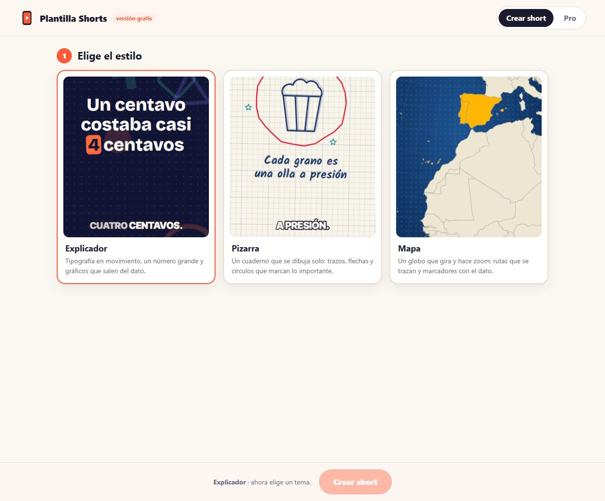
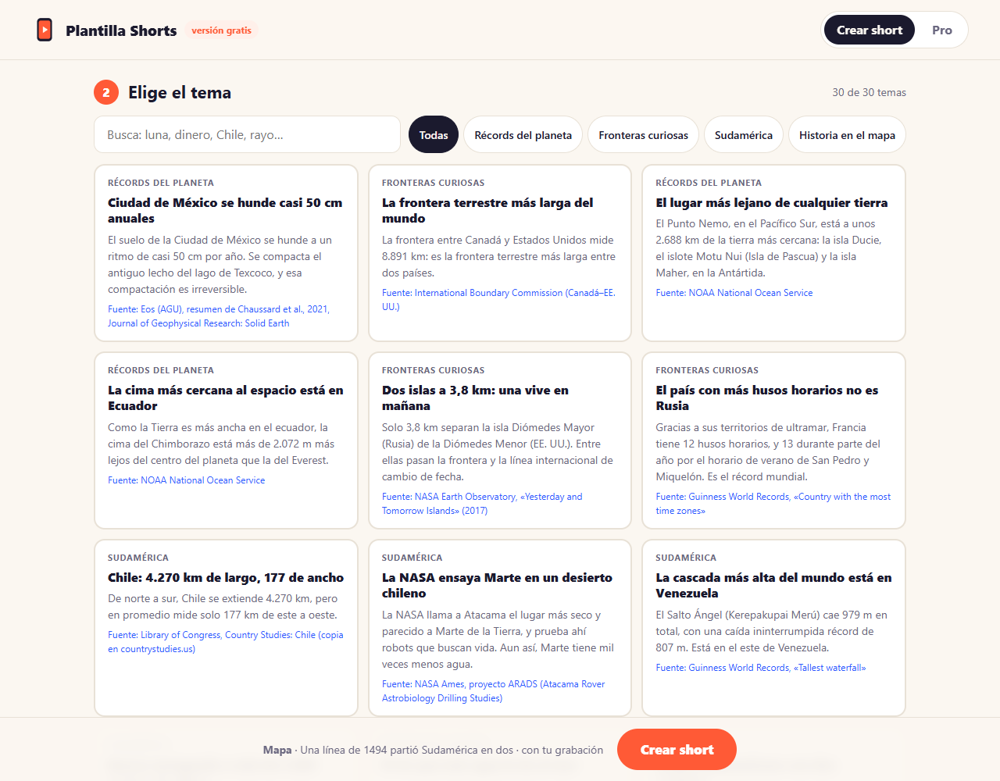
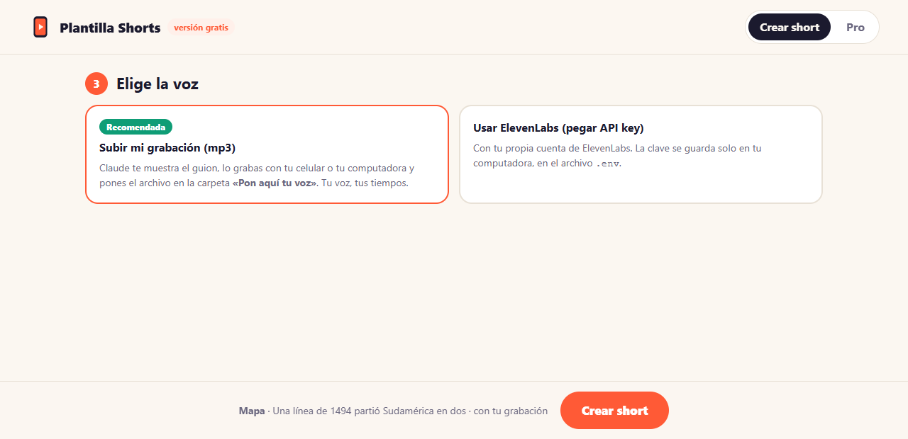

# Plantilla Shorts · versión gratis

Crea YouTube Shorts animados (30 a 45 segundos, vertical 1080 × 1920) con datos curiosos **verificados**, sin saber
programar. Eliges con clics y Claude hace el resto: guion, voz sincronizada, animación, subtítulos y control de calidad.

**Qué trae:** 3 estilos (Explicador, Pizarra y Mapa) y 90 temas con su fuente.
**Qué necesitas:** una computadora con Windows o Mac, la app de Claude con acceso a Claude Code y unos 2 GB libres.

---

## Paso 1 · Instala Node.js (una sola vez)

1. Entra a **https://nodejs.org** y descarga la versión que dice **LTS**.
2. Instálala con las opciones que vienen marcadas (siguiente, siguiente, instalar).
3. Si la app de Claude estaba abierta, ciérrala y vuelve a abrirla.

## Paso 2 · Descomprime la plantilla

Descomprime `PlantillaShorts-gratis-v1.zip` en un lugar fácil, por ejemplo el **Escritorio**. Te queda una carpeta
llamada **PlantillaShorts**.

## Paso 3 · Abre la carpeta en Claude

1. Abre la app de Claude y entra a la pestaña **Code**.
2. Elige la carpeta **PlantillaShorts** como carpeta de trabajo (el botón para elegir carpeta está junto al cuadro de mensaje).

## Paso 4 · Escribe `/shorts-gratis`

Escribe **/shorts-gratis** en el cuadro de mensaje y envíalo.

La primera vez, Claude revisa tu computadora y te pide permiso para instalar lo que falta (Remotion y los mapas, unos
400 MB). **Acepta.** Tarda unos minutos y no se repite.

## Paso 5 · Elige en el panel

Se abre una página en tu navegador:

1. **Estilo:** tócalo para ver cómo se mueve.
2. **Tema:** busca por palabra o por categoría. Cada tarjeta muestra el gancho, el dato y la fuente.
3. **Voz:**
   - **Subir mi grabación (Recomendada):** grabas el guion con tu celular o tu computadora.
   - **Usar ElevenLabs:** pegas tu API key de ElevenLabs y eliges una voz. La clave se guarda solo en tu computadora.
4. Toca **Crear short** y vuelve a la ventana de Claude.

> ¿No se abrió el navegador? Claude te muestra el enlace para abrirlo a mano. Si prefieres, te hace las mismas
> preguntas ahí mismo, en el chat.

## Paso 6 · Aprueba el guion y pon la voz

Claude te muestra el guion (unas 100 palabras). Elige **«Me sirve»** o **«Pedir cambios»**.

- **Con tu grabación:** lee el guion en voz alta y guarda el archivo (mp3, m4a o wav) en la carpeta
  **«Pon aquí tu voz»**. Claude lo detecta solo, recorta los silencios y sincroniza los subtítulos con tu voz. La
  primera vez instala un programa de transcripción que corre en tu computadora (unos 150 MB).
- **Con ElevenLabs:** antes de generar, Claude te dice cuántos caracteres va a gastar y te pide confirmación.
  Si usas ElevenLabs en videos monetizados, revisa que tu plan de ElevenLabs incluya uso comercial.

## Paso 7 · Abre tu short

Claude anima el video, revisa que los subtítulos no tapen nada y que el video no tenga partes quietas, y lo deja en la
carpeta **«Shorts listos»**:

- `nombre-del-short.mp4`: el video, listo para subir.
- `nombre-del-short.txt`: título, descripción con la fuente del dato y créditos.

Para hacer otro, vuelve a escribir **/shorts-gratis**.

---

## Problemas frecuentes

| Qué pasa | Qué hacer |
|---|---|
| Claude dice que falta Node | Repite el paso 1 y reinicia la app de Claude. |
| El navegador no abrió el panel | Copia el enlace que te muestra Claude (empieza con `http://127.0.0.1`) en tu navegador, o pídele que te pregunte en el chat. |
| Claude no encuentra tu grabación | Revisa que el archivo esté dentro de la carpeta «Pon aquí tu voz» y termine en .mp3, .m4a o .wav. |
| Los subtítulos no coinciden con lo que dijiste | Graba leyendo el guion tal cual, sin agregar frases. |
| ElevenLabs no acepta la clave | Cópiala de nuevo desde tu cuenta de ElevenLabs, completa. |
| El video tardó mucho | Es normal la primera vez (instala cosas). Después, cada short tarda unos minutos. |

## Bueno saber

- Todo corre en tu computadora: tus grabaciones y tu clave no se suben a ningún lado (salvo el guion, que va a ElevenLabs si eliges esa opción).
- Cada tema fue revisado contra su fuente (lista completa en `temas/VERIFICACION.md`).
- Licencia y créditos: `LICENCIA.md` y `OFL.txt`.
